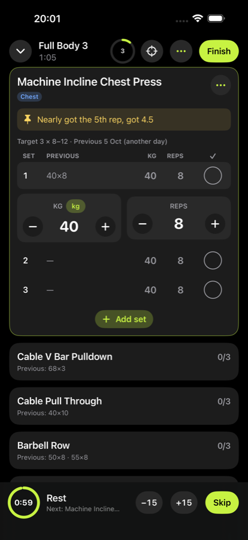
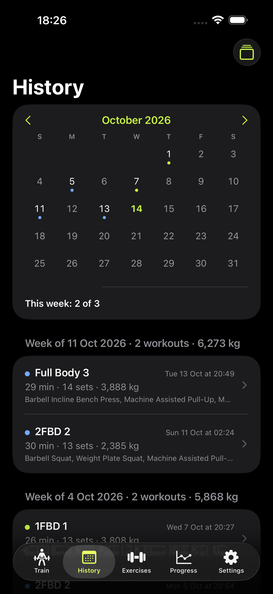
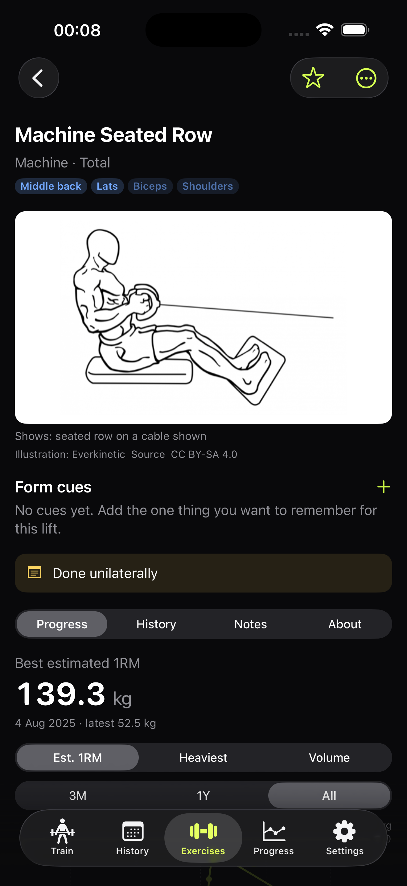
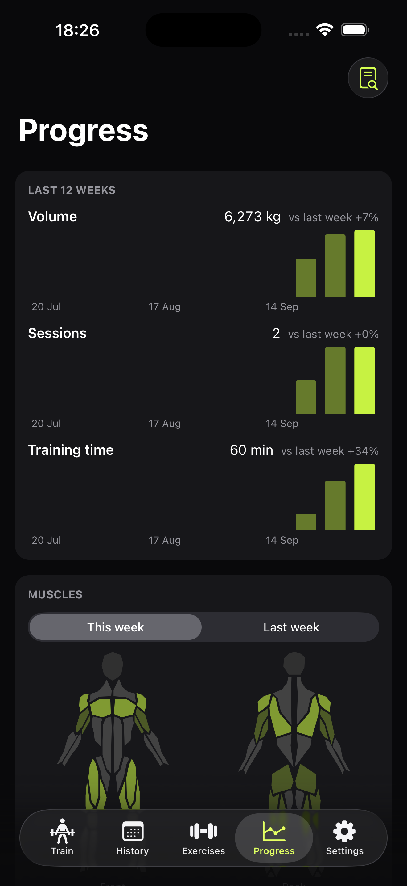

# GymApp (Bashi Gym)

A private, offline training log for one iPhone, built in SwiftUI. It keeps the training side
of JEFIT (exercises and how they're categorised, programs, set logging, the calendar and the
analytics) and drops the social feed, points, upsells and account. Everything lives on the
phone; nothing is sent anywhere.

**What exists today:** a complete training log on an SQLite database (GRDB), holding an
876-exercise library and four years of my JEFIT history (468 workouts, 7,751 sets, imported
in-app and matching a Python reference importer row for row).

- **Train:** programs for any split with a rolling rotation; a day editor that copies JEFIT
  days with their history; an exercise picker filtered to the day's focus; "Suggest a day".
- **Workout:** list and focus modes, prefill from the day's last session, every set saved
  immediately, resume after the app is killed, rest alerts and a lock-screen countdown, a
  mini-player, swaps, a plate calculator, and a summary with volume, records and muscles.
  Reps left (Max, 1, 2, 3) is one tap under each set. Bests are flagged as they happen
  (all-time, or best in 1/6/12 months after a break), each set shows what it would take to
  beat the best, supersets rotate with rest only after the round, a warm-up ramp can be
  switched on per exercise, and the end screen compares every lift with last time.
- **History:** a month calendar and every workout since 2022 by week; each workout opens to
  its sets and figures and can be corrected, with every figure recomputing.
- **Exercises:** search and filters; each page opens with an offline demonstration (a video,
  or two openly licensed poses shown as a slow loop, for 83% of the exercises I have logged),
  then form cues seeded from the library and editable, then the best estimated 1RM as the
  one headline figure, a progress chart where tapping a point shows that session, records
  with dates, history and notes. Chosen cues appear under the exercise during a workout.
- **Goals and standards:** a target estimated 1RM per lift with a projected date from your
  own curve, and where barbell lifts sit among gym lifters of your sex and weight (data
  Powered by FitnessVolt, CC BY 4.0).
- **Recaps:** this month, last month and a "Year in training" page for every year since 2022.
- **Progress:** 12 weeks of volume, sessions and time; sets per muscle on a body map; recovery
  over the last 72 hours; movement-pattern strength trends; recent records; body weight and
  daily steps, read from Apple Health with permission.
- **Studio suggestions:** next targets, swaps and notes published by GymApp Studio appear on
  Train with their reason, and change nothing until accepted.
- **Backups and export:** verified local recovery copies after every change, copies to a
  folder of my choosing, checked restores, and a Strong-compatible CSV of every set.
  [The export format](docs/EXPORT_FORMAT.md) is documented for tools built on the data.

Exercise figures are checked against an independent calculation from the raw export
(`tools/check_phase3.py`). [The roadmap](docs/ROADMAP.md) has the order and what "done"
means for each phase.

<p>




</p>


## Review guide

Start with [the training rulebook](docs/TRAINING_RULEBOOK.md): every number the app shows is
defined there. [The decisions](docs/DECISIONS.md) explain the constraints, and
[the JEFIT export notes](docs/JEFIT_EXPORT.md) cover the import format and its traps. In code,
[`TrainingMath`](GymApp/Domain/TrainingMath.swift) implements the rulebook and
[`Load`](GymApp/Domain/Load.swift) stores weights exactly as entered. Every phase is planned
card by card in [docs/specs](docs/specs); [HANDOFF.md](docs/HANDOFF.md) holds the live status.

## Status

| Phase | Focus | State |
|---|---|---|
| – | Workout-screen prototype on JEFIT data | done |
| 0 | Database, full JEFIT import, exercise library | done |
| 1 | Programs and the exercise library | done |
| 2 | Workout screen | done |
| 3 | History and analytics (lean) | done |
| 4 | Import, export and backups | done |
| 5 | On the phone ([setup](docs/PHONE_SETUP.md)) | done, installed |
| 6 | The phone side of the studio | done |
| 7 | Records, the workout flow and goals | done |
| 8 | Studio reports, data health, planner | done |
| 9 | Visual polish | done |
| 10 | Demonstrations, form cues, the exercise page, the studio's look | done |
| R | Redesign: plan navigation, workout card, end of workout, Progress, shared tokens, accessibility, Bashi Gym name and icon ([plan](docs/redesign/)) | done |

## GymApp Studio

A separate offline Mac program in [studio/](studio/README.md) reads the phone's backups and
does the heavy analysis: plateau and weak-point checks, next targets, a rule lab that replays
progression rules against the history, weekly and monthly reports, a typo finder, a block
planner, marimo notebooks, and an optional question box backed by Claude or a local model.
It has a sidebar, a toolbar and a ⌘K palette for pages and exercises. Rules are proven there before they move into the app, and its
suggestions reach the phone through the backup folder. [The plan](docs/STUDIO_PLAN.md) has
the design and the decisions behind it.

## The constraints this repo is shaped around

- **The gym has no signal and the Mac is at home.** Workouts live on the phone and are written
  after every set, so a session survives iOS killing the app while I'm in another app.
- **The phone is locked between sets.** Rest is stored as an absolute end time plus a local
  notification, so the alert fires whether the app is open, backgrounded or killed. That is
  why this is native and not a web app.
- **No paid Apple membership.** It installs with a free Apple ID. The install expires every
  seven days and is re-sent from Xcode; the data survives the re-send.
- **A chart is only as honest as its definitions.**
  - Dumbbell loads are per hand.
  - Assisted pull-ups count as body weight minus the assistance.
  - Warm-ups never count towards volume or records.
  - A load stays exactly as entered: 45 lb stays 45 lb.
  - Records, volume and estimated 1RM are computed from logged sets, never stored.

## Four years of history

The JEFIT export is the starting data, and it has traps:

```
JEFIT export, Aug 2022 – Oct 2026
  workouts                       492
  exercise entries             2,552
  exercises                      197 logged, plus 2 custom never used
  set rows vs summary string     781 agree, 115 disagree -> set rows win
                                 (checked against JEFIT's own history screen)
  assisted exercises               4, logged as positive help -> stored as negative
  bodyweight "weights"           JEFIT's 10 kg default, dropped on import
```

[`tools/build_jefit_map.py`](tools/build_jefit_map.py) classifies every exercise by
equipment, load mode, muscles and movement pattern. Its rules sit in one reviewable file,
with explicit overrides where they get an exercise wrong.

## Build

Requires Xcode 26 and the iOS 26 simulator.

```bash
git clone https://github.com/FuaadBashi/GymApp.git
cd GymApp
xcodebuild -project GymApp.xcodeproj -scheme GymApp \
  -destination 'platform=iOS Simulator,name=iPhone 17 Pro Max' build
```

The app seeds its bundled exercise library on first launch. Import a personal JEFIT
CSV from Settings, or create a program and exercises in the app.

## Tests

```bash
xcodebuild test -project GymApp.xcodeproj -scheme GymApp \
  -destination 'platform=iOS Simulator,name=iPhone 17 Pro Max'
```

## Layout

```
GymApp/App/          entry point, app delegate, theme
GymApp/Domain/       Load, SetType, exercise types, TrainingMath (the rulebook in code)
GymApp/Database/     schema, records, AppDatabase
GymApp/Import/       JEFIT reader, importer, import screen
GymApp/Library/      bundled library and exercise-map loading
GymApp/Services/     rest-timer notifications, recovery copies, Apple Health, studio inbox
GymApp/Data/         queries and writes for exercises, programs, workouts and summaries
GymApp/Features/     settings, exercise library, programs and workout screens
GymApp/Resources/    data bundled with the app: exercise library, JEFIT exercise map
GymAppTests/         unit tests (Swift Testing) and import fixtures
tools/               JEFIT parsing, exercise classification, library build, reference importer
third_party/         free-exercise-db, public domain
studio/              GymApp Studio: Python analysis server, web interface, Mac launcher
docs/                brief, decisions, roadmap, rulebook, export notes, specs, handoff
```
