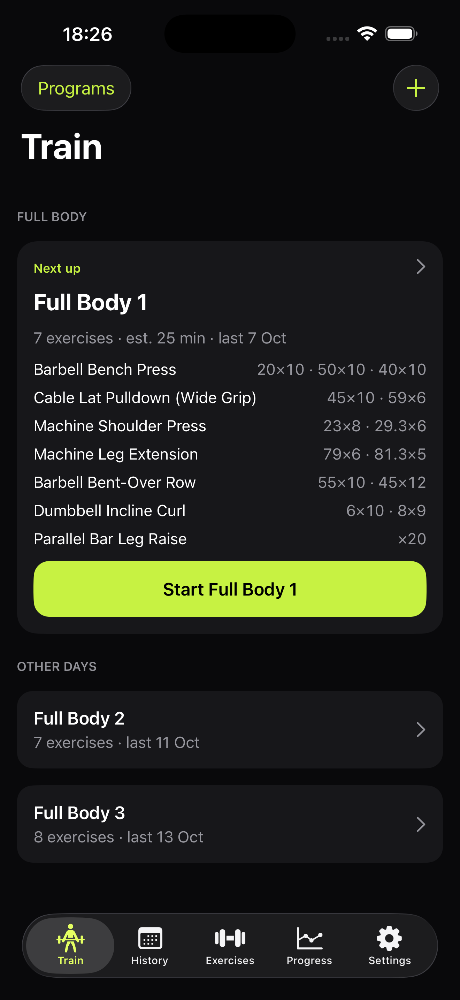

# GymApp

A private, offline training log for one iPhone, built in SwiftUI. It keeps the training side
of JEFIT (exercises and how they're categorised, programs, set logging, the calendar and the
analytics) and drops the social feed, points, upsells and account. Everything lives on the
phone; nothing is sent anywhere.

**What exists today:** the app's SQLite database (GRDB), holding an 876-exercise library
and four years of my JEFIT history. The history comes in through an in-app import: 468
workouts and 7,751 sets, matching a Python reference importer row for row, and safe to run
twice. On top of it: an Exercises tab (search, filters, history per exercise, notes, custom
exercises), programs for any split with a rolling rotation, a day editor that copies JEFIT
days across with their history, an exercise picker filtered to the day's focus, and
"Suggest a day", which fills a day from exercises I've actually done. Workouts now log
straight to the database, with list and focus modes, prefill from the day's history,
immediate set saves, resume after relaunch, rest alerts, a mini-player, swaps, added
exercises, a plate calculator and a summary with volume, records and muscles trained.
The prototype has been removed. A full Full Body 1 simulator session is verified.
The Live Activity target and countdown are implemented and visible on the simulator lock screen.
The rest alert fires at expiry; the activity changes to “Rest over” when iOS refreshes
its stale state, and clears on return (decision #37). Verified on the simulator.
**Phase 2 is complete.** History and Progress await the phase-3 spec.
The post-phase-2 additions now include checked recovery copies, backup-folder selection
and restore, autosaved set/session-exercise notes, effort labels (max rep and MR −1/−2/−3),
deload/injury/form annotations and warm-up selection. Offline stills and videos initially
cover barbell bench press and back squat; other variants explicitly show missing media.
Choose an independent folder in Settings → Backups & recovery to enable external copies.
[The roadmap](docs/ROADMAP.md) has the order and what "done" means for each phase.



## Review guide

Start with [the training rulebook](docs/TRAINING_RULEBOOK.md): every number the app shows is
defined there. [The decisions](docs/DECISIONS.md) explain the constraints, and
[the JEFIT export notes](docs/JEFIT_EXPORT.md) cover the import format and its traps. In code,
[`TrainingMath`](GymApp/Domain/TrainingMath.swift) implements the rulebook and
[`Load`](GymApp/Domain/Load.swift) stores weights exactly as entered. Phases 0–2 are planned
card by card in [docs/specs](docs/specs); [HANDOFF.md](docs/HANDOFF.md) holds the live status.

## Status

| Phase | Focus | State |
|---|---|---|
| – | Workout-screen prototype on JEFIT data | done |
| 0 | Database, full JEFIT import, exercise library | done |
| 1 | Programs and the exercise library | done |
| 2 | Workout screen | done |
| 3 | History and analytics | not started (deep analysis may move to a separate tool, decision #36) |
| 4 | Import, export and backups | not started |
| 5 | On the phone | not started |

## The constraints this repo is shaped around

- **The gym has no signal and the Mac is at home.** Workouts live on the phone and are written
  after every set, so a session survives iOS killing the app while I'm in another app.
- **The phone is locked between sets.** Rest is stored as an absolute end time plus a local
  notification, so the alert fires whether the app is open, backgrounded or killed. That is
  why this is native and not a web app.
- **No paid Apple membership.** It installs with a free Apple ID. The install expires every
  seven days and is re-sent from Xcode; the data survives the re-send.
- **A chart is only as honest as its definitions.**
  - Dumbbell loads are per hand.
  - Assisted pull-ups count as body weight minus the assistance.
  - Warm-ups never count towards volume or records.
  - A load stays exactly as entered: 45 lb stays 45 lb.
  - Records, volume and estimated 1RM are computed from logged sets, never stored.

## Four years of history

The JEFIT export is the starting data, and it has traps:

```
JEFIT export, Aug 2022 – Oct 2026
  workouts                       492
  exercise entries             2,552
  exercises                      197 logged, plus 2 custom never used
  set rows vs summary string     781 agree, 115 disagree -> set rows win
                                 (checked against JEFIT's own history screen)
  assisted exercises               4, logged as positive help -> stored as negative
  bodyweight "weights"           JEFIT's 10 kg default, dropped on import
```

[`tools/build_jefit_map.py`](tools/build_jefit_map.py) classifies every exercise by
equipment, load mode, muscles and movement pattern. Its rules sit in one reviewable file,
with explicit overrides where they get an exercise wrong.

## Build

Requires Xcode 26 and the iOS 26 simulator.

```bash
git clone https://github.com/FuaadBashi/GymApp.git
cd GymApp
xcodebuild -project GymApp.xcodeproj -scheme GymApp \
  -destination 'platform=iOS Simulator,name=iPhone 17 Pro Max' build
```

The app seeds its bundled exercise library on first launch. Import a personal JEFIT
CSV from Settings, or create a program and exercises in the app.

## Tests

```bash
xcodebuild test -project GymApp.xcodeproj -scheme GymApp \
  -destination 'platform=iOS Simulator,name=iPhone 17 Pro Max'
```

## Layout

```
GymApp/App/          entry point, app delegate, theme
GymApp/Domain/       Load, SetType, exercise types, TrainingMath (the rulebook in code)
GymApp/Database/     schema, records, AppDatabase
GymApp/Import/       JEFIT reader, importer, import screen
GymApp/Library/      bundled library and exercise-map loading
GymApp/Services/     rest-timer notifications
GymApp/Data/         queries and writes for exercises, programs, workouts and summaries
GymApp/Features/     settings, exercise library, programs and workout screens
GymApp/Resources/    data bundled with the app: exercise library, JEFIT exercise map
GymAppTests/         unit tests (Swift Testing) and import fixtures
tools/               JEFIT parsing, exercise classification, library build, reference importer
third_party/         free-exercise-db, public domain
docs/                brief, decisions, roadmap, rulebook, export notes, specs, handoff
```
