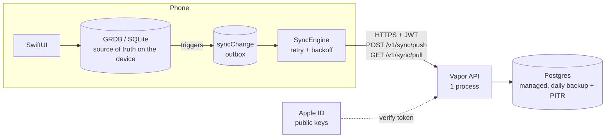

# Backend plan: sync for Bashi Gym

Status: plan only. No code until the owner approves part 6. Purpose: practice. The design
must also work if the app goes live.

Target: 20,000 downloads, 1,000+ daily active users.

## 1. Load, on the back of an envelope

Assumptions (round numbers; change them and the result stays small):

| Item | Value |
|---|---|
| Active users a day | 1,000 |
| Sessions a day | 1,000 (one each, worst case) |
| Sets a session | 25 |
| Sets a day | 25,000 |
| Share of a day's sets in the busiest hour | 20% |
| Pulls (app opens) a user a day | 5 |

Writes. The phone pushes after each set when it is online, so there is one push a set.

- Average: 25,000 / 86,400 s = **0.3 pushes/s**.
- Busiest hour: 5,000 / 3,600 s = **1.4 pushes/s**.
- 10× peak (the design target): **14 pushes/s**.

Reads: 5,000 pulls a day = 0.06/s on average, and **about 3/s at 10× peak**.

Storage. A set row in Postgres is about 200 bytes with its indexes.

- 25,000 × 365 = 9.1 million rows a year = **about 2 GB a year**.
- Workouts, workout exercises and notes add about 20%.

Conclusion: **one small Postgres and one API process are enough.** A single Postgres takes
thousands of simple writes a second. The limit is disk size, not speed. Sharding, queues,
caches and microservices are not needed. This is the main point to make in an interview:
measure first, then choose the smallest design that has a clear margin.

## 2. Architecture



### The options

| | Local-first + own API + Postgres (chosen) | Firebase / Supabase direct from the phone | CloudKit |
|---|---|---|---|
| Works offline | Yes, the phone database is unchanged | Partly; their caches replace GRDB, or run beside it | Yes, with CKSyncEngine |
| Fits the rules (sets saved at once, loads as entered, derived numbers) | Yes, unchanged | Needs a second data layer | Yes |
| Server logic (checks, export, delete) | Ours, in one place | Security rules / RLS policies | None; Apple holds the data |
| Android or web later | Yes | Yes | No (Apple only) |
| Interview value | High: you can explain each layer | Medium | Low |
| Cost at this size | Free to about $25/month | Free tier, then about $25/month | Free (user's iCloud) |
| Lock-in | Low (plain Postgres) | High (Firebase), medium (Supabase) | High |

**Choice: local-first sync to a Vapor API and one Postgres.** The reasons:

- It keeps the phone app as it is.
- Swift on both ends lets the server share types and checks with the app.
- Postgres is portable.

CloudKit is the cheapest real option for an iPhone-only app. It is the fallback if the goal
changes from "learn and defend a backend" to "only back up my data".

### Hosting and cost (to check before deploying; prices change)

| Stage | Where | Cost |
|---|---|---|
| Practice | Vapor and Postgres on the Mac (Docker), phone or simulator on the local network | Free |
| First deploy | API on Render's free tier (it sleeps when idle) + Neon or Supabase free Postgres (0.5 GB) | Free |
| Live at 1,000 users a day | Small always-on API instance + paid Postgres with point-in-time restore (2 GB/year fits the base plan) | About $25–35/month |

Decision (21 October): **free tiers first.** Move to a paid plan only when the database reaches
80% of the free limit. At full load, that is after about three months. server/README.md has
the size query to run each week.

## 3. Data model

### What already exists on the phone

Every table in `GymApp/Database/Schema.swift` already has `id TEXT PRIMARY KEY`, made with
`UUID().uuidString` on the device. Library exercises use stable text IDs from the bundled
file. **So no migration to add UUIDs is needed.** What is missing for sync:

- an `updatedAt` on each synced row;
- a record of deletes. Today the app removes rows with a hard `DELETE`, for example
  `WorkoutWrites.swift` when an unfinished set is cleared;
- an outbox of changes not yet sent.

### Phone migration v10 (the hello world needs only `workoutSet`)

```sql
ALTER TABLE workoutSet ADD COLUMN updatedAt TEXT;   -- ISO-8601 UTC, set by trigger

CREATE TABLE syncChange (
  seq INTEGER PRIMARY KEY AUTOINCREMENT,        -- local order
  tableName TEXT NOT NULL,
  rowId TEXT NOT NULL,
  op TEXT NOT NULL CHECK (op IN ('upsert','delete')),
  changedAt TEXT NOT NULL
);
CREATE INDEX syncChange_row ON syncChange(tableName, rowId);

-- Triggers catch every writer: the UI, imports, intents and restores.
CREATE TRIGGER workoutSet_ins AFTER INSERT ON workoutSet BEGIN
  INSERT INTO syncChange(tableName,rowId,op,changedAt)
  VALUES ('workoutSet', NEW.id, 'upsert', strftime('%Y-%m-%dT%H:%M:%fZ','now'));
END;
CREATE TRIGGER workoutSet_upd AFTER UPDATE ON workoutSet BEGIN ... same, 'upsert' ... END;
CREATE TRIGGER workoutSet_del AFTER DELETE ON workoutSet BEGIN ... same, OLD.id, 'delete' ... END;
```

The phone keeps hard deletes. The outbox remembers them, and the server stores the
tombstone. The sync engine sends the newest state of each row: it collapses many outbox
entries for one row into one change.

Rules kept:

- `loadHundredths` + `unit` go to the server as entered, with no conversion.
- Records, volume and summaries are not stored on the server either. Each device derives
  them with `TrainingMath`.

### Postgres schema (the full target; the hello world creates `users` and `workout_set`)

```sql
CREATE TABLE users (
  id            uuid PRIMARY KEY DEFAULT gen_random_uuid(),
  apple_sub     text UNIQUE NOT NULL,         -- Sign in with Apple subject
  change_seq    bigint NOT NULL DEFAULT 0,    -- per-user change counter (section 4)
  created_at    timestamptz NOT NULL DEFAULT now(),
  deleted_at    timestamptz
);

-- Every synced table has the same five sync columns:
--   user_id, id (client UUID), updated_at (client), server_seq, deleted (tombstone)
CREATE TABLE workout_set (
  user_id              uuid NOT NULL REFERENCES users(id) ON DELETE CASCADE,
  id                   text NOT NULL,                 -- client UUID
  workout_exercise_id  text NOT NULL,
  position             int  NOT NULL CHECK (position >= 0),
  load_hundredths      int,
  unit                 text NOT NULL CHECK (unit IN ('kg','lb')),
  reps                 int  NOT NULL CHECK (reps >= 0),
  type                 text NOT NULL CHECK (type IN ('working','warmUp','failed','drop')),
  completed_at         timestamptz,
  rpe                  real CHECK (rpe BETWEEN 1 AND 10),
  reps_in_reserve      int  CHECK (reps_in_reserve BETWEEN 0 AND 3),
  note                 text,
  updated_at           timestamptz NOT NULL,
  server_seq           bigint NOT NULL,
  deleted              boolean NOT NULL DEFAULT false,
  PRIMARY KEY (user_id, id)
);
CREATE INDEX workout_set_pull ON workout_set(user_id, server_seq);

-- Same pattern for exercise, workout and workout_exercise:
CREATE TABLE exercise (user_id uuid, id text, name text NOT NULL, equipment text NOT NULL,
  load_mode text NOT NULL, source text NOT NULL, is_archived boolean NOT NULL DEFAULT false,
  ..., updated_at timestamptz NOT NULL, server_seq bigint NOT NULL,
  deleted boolean NOT NULL DEFAULT false, PRIMARY KEY (user_id, id));
CREATE TABLE workout (user_id uuid, id text, started_at timestamptz NOT NULL,
  ended_at timestamptz, title text NOT NULL, note text, effort int, ...,
  updated_at timestamptz NOT NULL, server_seq bigint NOT NULL,
  deleted boolean NOT NULL DEFAULT false, PRIMARY KEY (user_id, id));
CREATE TABLE workout_exercise (user_id uuid, id text, workout_id text NOT NULL,
  exercise_id text NOT NULL, position int NOT NULL, ...,
  updated_at timestamptz NOT NULL, server_seq bigint NOT NULL,
  deleted boolean NOT NULL DEFAULT false, PRIMARY KEY (user_id, id));
```

Design notes:

- **No foreign keys between synced tables on the server.** Changes can arrive out of order;
  for example, a set can arrive before its workout. The phone enforces the links, and the
  server stores what it gets. This is normal for sync servers.
- **The key is `(user_id, id)`, not `id` alone.** One user can never overwrite another
  user's row, even with a guessed ID.
- The phone's "one workout in progress" and "one active program" indexes stay on the phone.
  The server does not repeat them, because two devices can each be in a valid state while
  they are out of sync.

## 4. Sync protocol

### Push

`POST /v1/sync/push`, with a body of at most 200 changes:

```json
{ "changes": [
  { "table": "workoutSet", "id": "8C1E…", "op": "upsert", "updatedAt": "2026-10-21T18:02:11.204Z",
    "row": { "workoutExerciseId": "…", "position": 2, "loadHundredths": 10000, "unit": "kg",
             "reps": 8, "type": "working", "completedAt": "…" } },
  { "table": "workoutSet", "id": "51AF…", "op": "delete", "updatedAt": "…" } ] }
```

The server does this in **one transaction**:

1. `UPDATE users SET change_seq = change_seq + n WHERE id = $user RETURNING change_seq`.
   This locks the user's row, so the pushes of one user run one at a time. Each change gets
   a seq with no gaps and in commit order.
2. For each change, an idempotent upsert with last-writer-wins:

   ```sql
   INSERT INTO workout_set (user_id, id, ..., updated_at, server_seq, deleted)
   VALUES ($user, $id, ..., $updatedAt, $seq, $isDelete)
   ON CONFLICT (user_id, id) DO UPDATE SET ... = EXCLUDED....
   WHERE workout_set.updated_at < EXCLUDED.updated_at;
   ```

3. Reply `200 { "accepted": [ids] }`. A change that loses to a newer one is still
   "accepted": the newer row wins, and the phone gets it at the next pull.

Why the same push can run twice: the key is the client UUID, and the `WHERE` makes a second
copy of the same change do nothing. A retry after a timeout cannot add a row.

Why there is a per-user counter and not a global sequence: Postgres sequences can commit out
of order. A reader then can move its cursor past a row that is not yet visible, and miss it
for ever. The lock on the user's row stops this. The cost is that one user's pushes run one at
a time, which is not a problem at a few pushes a second.

### Pull

`GET /v1/sync/pull?since=<server_seq>&limit=500` returns:

- the rows with `user_id = $user AND server_seq > since`, ordered by `server_seq`, with
  tombstones included;
- `nextCursor`;
- `hasMore`.

The phone applies the rows in one GRDB transaction, then stores the cursor. When it applies
pulled rows, it pauses the outbox triggers (for example with a `syncApplying` flag in a temp
table), so the pulled rows do not go back to the server.

### Conflict rule

Last writer wins, per row, by the client `updatedAt`:

- **Simple:** a training log rarely has two devices that edit the same set.
- **Limit:** a phone with a wrong clock can win. That is acceptable here. A hybrid logical
  clock is the upgrade if a second device becomes common.
- **Deletes:** a delete is a change with a newer `updatedAt`, so it beats an older edit.

### Retry and backoff (the phone's SyncEngine)

The SyncEngine runs on these triggers:

- after each set is saved;
- when the app opens;
- when `NWPathMonitor` reports that the network is back;
- from a `BGAppRefreshTask`.

How it sends and retries:

- It sends one batch at a time, oldest first. It removes outbox rows only after a `200`.
- On a network error or a 5xx, it waits 1, 2, 4, … up to 300 seconds, with ±20% jitter. On
  `429`, it uses the `Retry-After` value.
- On a 4xx with a bad change, it moves that change to a `syncDeadLetter` table. A bad change
  never blocks the queue. Settings shows a count.
- Logging a set never waits for sync. The set is in GRDB first. This is the rule that each
  logged set is written to the database immediately.

```mermaid
sequenceDiagram
  participant U as User
  participant DB as GRDB (phone)
  participant SE as SyncEngine
  participant API as Vapor API
  participant PG as Postgres
  U->>DB: Log set (100.00 kg × 8)
  DB->>DB: trigger → syncChange (upsert)
  DB-->>U: Saved (no network needed)
  SE->>DB: read outbox batch
  SE->>API: POST /v1/sync/push (JWT)
  API--xSE: network drops (timeout)
  Note over SE: wait 1 s, 2 s, 4 s … (jitter)
  SE->>API: POST /v1/sync/push (same batch)
  API->>PG: BEGIN; lock user, seq += n
  API->>PG: upsert ON CONFLICT … WHERE older
  API->>PG: COMMIT
  API-->>SE: 200 accepted
  SE->>DB: delete sent outbox rows
  Note over SE,PG: Other device: GET /v1/sync/pull?since=cursor → rows + nextCursor
```

## 5. Security and privacy

- **Sign in with Apple.**
  1. The phone sends Apple's identity token once, to `POST /v1/auth/apple`.
  2. The server checks the token's signature against Apple's public keys (JWKS). It also
     checks that `iss` is `https://appleid.apple.com`, that `aud` is the bundle ID, and that
     the token has not expired.
  3. It then finds or creates the user by `sub`.
  4. It returns its own access token (JWT, 15 minutes) and a refresh token. The server
     stores only a hash of the refresh token.
- **Token check on each request.** Vapor middleware checks the JWT and puts `userId` on the
  request. No route takes a user ID from the body or the URL.
- **Row ownership.** Each query has `user_id = $authUser`, and the primary key contains
  `user_id`. A second layer is possible: Postgres row-level security with
  `SET LOCAL app.user_id`. Decide this at build time; it costs one line for each
  transaction.
- **TLS.** HTTPS only (the host gives the certificate). Turn on HSTS, and keep App Transport
  Security on its defaults.
- **Abuse limits.**
  - Body size at most 1 MB.
  - At most 200 changes for each push.
  - A rate limit for each user of 10 requests/s, with bursts.
  - Each field is checked with the same rules as the phone's CHECK constraints.
- **Backups.**
  - The managed host's daily backup, plus point-in-time restore (paid tier).
  - A weekly `pg_dump` to a second place.
  - Test a restore once before launch: a backup that was never restored is not proof.
- **Export and delete (GDPR / App Store rule 5.1.1(v)).**
  - `GET /v1/account/export` returns all of the user's rows as JSON. The phone already has
    an export format (docs/EXPORT_FORMAT.md), so reuse it.
  - `DELETE /v1/account` hard-deletes the user, and the rows go with it through
    `ON DELETE CASCADE`. The app must offer account deletion in the app.
  - Backups age out within 30 days.
- **Secrets.** The JWT signing key and the database URL live in host environment variables,
  not in git. The phone keeps tokens in the Keychain.

## 6. Hello world: sync `workoutSet` end to end

The goal:

1. Log a set while offline.
2. Turn the network on, and see the row in Postgres.
3. Reinstall the app, and pull the row back.

The server stores `workout_exercise_id` as plain text with no link (section 3), so this
works before the other tables sync.

### New dependencies: approval needed

| Where | Package | Why |
|---|---|---|
| Server (separate SwiftPM package; no change to the app's Xcode project) | `vapor/vapor` 4 | HTTP server |
| Server | `vapor/fluent-postgres-driver` (or only `vapor/postgres-nio`) | Postgres access. The plan prefers postgres-nio with plain SQL: the upsert above is SQL in any case |
| Server | `vapor/jwt` | Our tokens + Apple JWKS check |
| Tools (not shipped) | Docker, k6 (`brew install k6`) | Local Postgres; load test |

The app needs **no new dependency**. It uses URLSession, Network (`NWPathMonitor`) and
BackgroundTasks, all from the system.

### Files

Server, the new folder `server/`:

| File | What |
|---|---|
| `server/Package.swift` | Package with the three dependencies above |
| `server/docker-compose.yml` | Postgres 16 for development and tests |
| `server/Sources/App/configure.swift` | Database pool, migrations, middleware, routes |
| `server/Sources/App/Migrations.swift` | `users`, `workout_set` (section 3 SQL) |
| `server/Sources/App/Auth.swift` | Apple token check, token issue, `UserAuthenticator` middleware |
| `server/Sources/App/SyncController.swift` | `push` (one transaction, lock, upsert) and `pull` |
| `server/Sources/App/SyncDTO.swift` | Codable change/row types and field checks |
| `server/Tests/AppTests/SyncTests.swift` | The tests below, against the Docker Postgres |
| `server/loadtest/sync.js` | k6 script |
| `server/README.md` | Run, test and deploy steps |

App:

| File | What |
|---|---|
| `GymApp/Database/Schema.swift` | Migration v10: `workoutSet.updatedAt`, `syncChange`, `syncState` (cursor), `syncDeadLetter`, three triggers |
| `GymApp/Sync/SyncTransport.swift` | A protocol with `push`/`pull`, the URLSession version, and a fake for the tests |
| `GymApp/Sync/SyncEngine.swift` | Outbox drain, collapse, backoff, pull-apply with triggers paused |
| `GymApp/Sync/SyncAuth.swift` | Sign in with Apple button flow, Keychain tokens |
| `GymApp/Features/Settings/…` | A "Sync (beta)" row: sign in, server URL (debug), last sync, error count |
| `GymAppTests/SyncEngineTests.swift` | The app-side tests below |
| `GymApp.entitlements` | The Sign in with Apple capability. **This is a project-file change**, so it needs approval. It can wait: the hello world can use a development token first |

### Done when (the checks)

1. **Load test.** `k6 run server/loadtest/sync.js` with 200 virtual users:
   - 14 pushes/s (10× peak), each of one set;
   - 3 pulls/s;
   - 5 minutes, against the deployed instance.

   Pass: **p95 latency < 300 ms**, and errors < 0.1%.
2. **Network drop, no loss** (`SyncEngineTests`):
   1. The fake transport fails the first 3 pushes.
   2. Log 5 sets. All 5 are in GRDB at once.
   3. The engine backs off, then sends.
   4. The server fake holds exactly 5 rows with the same values (`loadHundredths`, `unit`,
      `reps`), and the outbox is empty.

   Also check by hand on the device: put it in airplane mode, log, turn airplane mode off,
   and see the row in Postgres.
3. **The same push twice gives one row** (`SyncTests`). POST the same batch twice, and also
   two copies in parallel. `SELECT count(*)` is 1, and `server_seq` moved only once for the
   second identical copy (the `WHERE` skipped it).
4. **One user cannot read another user's rows** (`SyncTests`):
   1. User A pushes a set.
   2. User B pulls with `since=0` and gets none of A's rows.
   3. User B pushes a change with A's row ID. This creates B's own row, and A's row does
      not change.
   4. A request with no token, or with an expired or wrongly signed one, gets `401`.
5. **Last writer wins** (`SyncTests`). An older `updatedAt` after a newer one changes
   nothing. A delete with a newer time leaves a tombstone, which a pull returns.
6. The app's full test command passes (`** TEST SUCCEEDED **`).

## Status: hello world built (21 October 2026)

Approved and built: `server/` (Vapor, postgres-nio, JWT), migration v10, `GymApp/Sync/`, and
Settings → Sync (beta).

Results:

| Check | Result |
|---|---|
| 1. k6 at 10× peak, 5 min, local server (debug build, Postgres 17 on the Mac) | p95 **10 ms**, 0 of 5,301 requests failed. A run against a deployed host is still to do. |
| 2. Network drop, no loss | `SyncEngineTests.setsLoggedOfflineSyncAfterTheNetworkReturns`: 3 failed pushes, then all 5 sets arrive with the same values |
| 3. Same push twice gives one row | `SyncTests.testSamePushTwiceGivesOneRow`, both in sequence and in parallel; `server_seq` does not move |
| 4. Users are isolated | `SyncTests.testUsersCannotReadOrOverwriteEachOther` and the 401 test |
| 5. Last writer wins, tombstones | `SyncTests.testLastWriterWinsAndTombstones` |
| End to end | `SyncServerIntegrationTests`: a set from one in-memory phone reaches another through the real server |

Changes from the plan, and the reasons:

- **No `updatedAt` column on `workoutSet`.** The outbox's `changedAtMs` is the change time,
  and a pulled row is not compared on the phone: the server has already applied
  last-writer-wins. A pulled row with unsent local changes is skipped, and the local push
  decides it.
- **The triggers record changes only after sync is turned on.** Turning it on puts every
  existing set in the outbox once. Users who never sync pay nothing.
- **Sets whose workout is not on the phone yet are parked** in `syncParked`, and tried again
  on each pull. This lasts until workouts and exercises sync too.
- **Sign-in uses the development route only** (`AUTH_DEV=1`). The Apple route is written but
  needs the Sign in with Apple entitlement (a project-file change) and a device to test.
- **No dead-letter table yet.** A rejected push (4xx) stops the run, and the changes stay in the
  outbox. Settings shows the error.
- **Sync runs when the app opens and from Settings → Sync now.** A trigger on network-path
  change and background refresh is not built yet.
- **The phone can reach the server only on the simulator (localhost).** A real phone needs HTTPS
  (a deployed host). Plain HTTP to a LAN address needs an App Transport Security exception,
  which is an Info.plist change.

### Step 2 built: all four tables (21 October 2026)

The tables are `exercise`, `workout`, `workoutExercise` and `workoutSet`. Here is how the step
differs from section 3:

- **The server stores one table, `sync_row`,** with the key `(user_id, table_name, id)` and the
  row as `jsonb`. This replaces one typed table for each kind of row.
  - The server decodes each kind into its own struct, and checks it there: the rules match the
    phone's CHECK constraints.
  - It stores the JSON as it was sent, so a new field on the phone needs no server change.
  - The server never queries inside a row, so typed columns would add code and gain nothing.
- **Migration v11** adds a trigger on each of the three new tables. A bundled library exercise
  is sent only when it is changed on this phone. Seeding uses `INSERT OR IGNORE`, which fires no
  trigger. When sync is turned on, an existing library exercise goes only if it is a favourite,
  is archived or has a note.
- **Pull order.** The phone writes parents first. A child whose parent is not there yet is
  parked, and so is a row that breaks a local rule (a second workout in progress). After each
  page, the phone tries the parked rows again until no more of them can be written.
- **Saving.** Rows are saved with update-then-insert, never `REPLACE`, which would delete the
  children through the cascade.
- **Links that are dropped.** A link to a program day, day item or library entry that this phone
  does not have is set to NULL. Programs do not sync yet.

Tests:

- Server: 9 tests.
  - An exact round trip of each kind of row, including fields that the server does not know.
  - The same ID in two tables gives two rows.
  - The checks for each kind of row.
- App: 10 sync tests.
  - A whole workout arrives on a second phone, with no echo back to the server.
  - Children that arrive before their parents are parked, then written.
  - A second workout in progress is parked until the phone's own workout ends.
  - Library exercises that were not changed are never sent.
  - Each kind of row survives the wire exactly.
- Integration: a workout logged on one phone arrives on another through the real server.

Next:

2. Deploy to Render and Neon (free), then run k6 against the deployed host.
3. Sign in with Apple.
4. Account export and delete.
