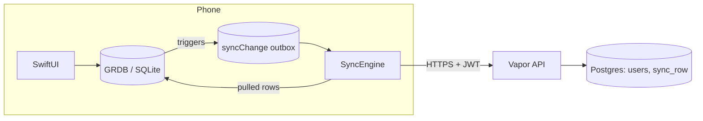

# Sync backend: build log and decisions

This document records what was built for the sync backend, why each choice was made, and what
was rejected. It is the companion to [01-plan.md](01-plan.md), which is the plan.
[server/README.md](../../server/README.md) has the commands to run, test and deploy.

Dates are October 2026. "Owner" means the person who directs the product.

## 1. Summary

The app can now send its training log to a server and get it back on another phone.

- **Phone:** SQLite (GRDB) stays the source of truth. An outbox, filled by database triggers,
  records each change. A sync engine sends the changes and applies the server's changes.
- **Server:** one Vapor process and one Postgres database. Each user's rows are stored by
  `(user, table, id)` with last-writer-wins and tombstones.
- **What syncs:** exercises, workouts, workout exercises and sets.
- **What does not sync yet:** notes, body entries, form cues, settings. (Programs, program days
  and day items sync since step 4.)
- **State:**
  - It runs on the Mac and in the simulator.
  - The hosting is prepared, but it is not deployed: it needs the owner's own sign-ups.
  - The goal is practice and interview preparation, not a launch.

## 2. Timeline

| Commit | Step | What |
|---|---|---|
| `cf0ed9c` | Plan | docs/backend/01-plan.md: load figures, the options, the schema, the protocol, security, the first slice |
| `7dad904` | Step 1 | The server, migration v10, the sync engine, Settings → Sync (beta). Sets only |
| `587eed6` | Step 2 | Exercises, workouts and workout exercises. One generic server table. Migration v11 |
| `9112689` | Step 3 (prepared) | Dockerfile, Render blueprint, `DATABASE_URL` with TLS, `/health` |
| `ac75cba`, `8909bbf` | Step 3 | The server in Render's Ohio region next to Neon; Neon's free tier corrected to 1 GB |
| `83519cd`, `6ed4a54` | Step 3 | Two first-build fixes: Swift 6.4.1 (the pinned packages need tools 6.4), and the test folder copied into the build (the manifest declares it). Deployed and live on 21 October |

## 3. Decisions

Each decision gives what was chosen, the reason, what was rejected, and who decided.

### 3.1 Scope and goal

| # | Decision | Reason | Rejected | By |
|---|---|---|---|---|
| D1 | Design for 20,000 downloads and 1,000+ users a day | The owner's target; it sets the load figures | — | Owner |
| D2 | Practice first, not a launch | The owner's answer. App Store privacy labels and in-app account deletion are left for a launch | Launch-ready work now | Owner |
| D3 | Plan first, no code until approval | The owner's way of working on large work | Building straight away | Owner |
| D4 | Free tiers first. Pay only at 80% of the free database limit | The owner's answer. At full load, the free tier is full in about five months; at practice load, never | Paying from the start | Owner |

### 3.2 Architecture

| # | Decision | Reason | Rejected | By |
|---|---|---|---|---|
| D5 | **Local-first sync:** the phone database stays the truth, and the server is a copy that other devices share | The app is offline-first already: a basement gym has no signal. The rules ("each set saved at once", "loads as entered", "derived, never stored") stay true without change | Firebase or Supabase used directly from the phone: a second data layer beside GRDB, and lock-in. CloudKit: the cheapest, but Apple only, little to explain in an interview, and no server logic | Plan, approved by the owner |
| D6 | **One API process and one Postgres** | Load figures: 0.3 writes/s on average, 14/s at 10× peak, about 2 GB a year. One Postgres takes thousands of simple writes a second | Microservices, queues, caches, sharding: none is needed at this load | Plan |
| D7 | **Vapor (Swift)** for the server | The owner's choice. One language on both sides; the same Codable types | TypeScript or Go (more common in interviews) | Owner |
| D8 | **postgres-nio with plain SQL**, not Fluent (the ORM) | The upsert with its `WHERE` is SQL in any case. One small dependency instead of two. The SQL is visible, which is easier to explain | Fluent | Plan, approved by the owner |
| D9 | The server is a **separate Swift package** (`server/`), not a target in the Xcode project | No `project.pbxproj` change. The phone app does not depend on Vapor | A server target in GymApp.xcodeproj | Build |
| D10 | Dependencies: `vapor`, `postgres-nio`, `jwt` on the server, and `k6` as a tool. **None in the app** | The app uses only system frameworks (URLSession, Foundation) | — | Owner approved |

### 3.3 Phone data and the outbox

| # | Decision | Reason | Rejected | By |
|---|---|---|---|---|
| D11 | **No migration to UUIDs** | Every table already has a text ID made on the phone with `UUID()`. Library exercises have stable bundled IDs. The plan expected this migration; reading the schema showed that it was not needed | The UUID migration the plan listed | Build |
| D12 | **SQLite triggers fill the outbox** (`syncChange`) | A trigger catches every writer: the UI, the imports, the lock-screen Log button, restores. A hook in the app code would miss a writer sooner or later | Recording changes in each write function | Plan |
| D13 | **The triggers record only after sync is turned on.** Turning it on puts every existing row in the outbox once | Users who never sync pay nothing: no outbox rows, no write cost | Recording always | Build |
| D14 | **No `updatedAt` column on the phone's tables.** The outbox's `changedAtMs` is the change time | A pulled row is not compared on the phone, because the server has already applied last-writer-wins. One less column on every table | An `updatedAt` column on each table (the plan) | Build; plan updated |
| D15 | **A pulled row with unsent local changes is skipped** | The local change is newer from this phone's point of view. Its push decides the result on the server, and the next pull brings the winner | Applying the pulled row and losing the local edit | Build |
| D16 | **A flag row `applying` in `syncState` pauses the triggers** while pulled rows are written | Pulled rows must not go back to the server. SQLite triggers in the main schema cannot read a temporary table, so the flag is an ordinary row, set and cleared inside the same transaction | A temporary table (not allowed); turning triggers off (not possible in SQLite) | Build |
| D17 | **The phone keeps its hard deletes.** The outbox records the delete, and the server stores a tombstone | No change to the existing app code or its tests. Other devices still learn about the delete | Soft deletes on the phone | Plan |
| D18 | **Migrations v10 and v11 are added. Neither changes an earlier migration** | The project rule: never edit a shipped migration. v11 drops and re-creates `syncParked`, because it held only test data | Editing v10 | Build |
| D19 | **Bundled library exercises are sent only when changed on this phone** (a favourite, archived, or a note). Seeding uses `INSERT OR IGNORE`, which fires no trigger | Each phone has the library already. Sending about 900 unchanged rows for each user would waste space | Sending the full library | Build |

### 3.4 Wire format and protocol

| # | Decision | Reason | Rejected | By |
|---|---|---|---|---|
| D20 | **Dates are milliseconds since 1970** on the wire | Exact round trip between Foundation on both sides. ISO 8601 without fractions loses milliseconds | ISO 8601 strings | Build |
| D21 | **The phone's records go on the wire as they are** (`ExerciseRecord`, `WorkoutRecord` and the others), as JSON | No second set of types to keep in step with the first | Separate data-transfer types on the phone | Build |
| D22 | **Push: at most 200 changes. Pull: at most 500 rows a page**, with `nextCursor` and `hasMore` | A small, fixed request size. A first sync of a long history goes in pages | Unlimited batches | Plan |
| D23 | **Many edits of one row go as one change** (the newest state), in the order the rows were first changed | Fewer writes. Parents are normally changed before their children, so they go first | Sending each edit | Plan |
| D24 | **A per-user change counter** (`users.change_seq`), taken under a row lock in each push transaction | Postgres sequences can commit out of order. A reader then moves its cursor past a row that is not yet visible, and misses it for ever. The lock makes one user's pushes run one at a time; the cost is nothing at this load | One global sequence | Plan |
| D25 | **Idempotent upsert:** `ON CONFLICT … DO UPDATE … WHERE stored.updated_at < new.updated_at` | A retry after a timeout, or two copies at the same time, cannot add a row or move the counter | Rejecting duplicates by a request ID | Plan |
| D26 | **Last writer wins, per row, by the phone's change time** | Simple. A training log rarely has two devices that edit the same set. Limit: a phone with a wrong clock can win. The upgrade path is a hybrid logical clock | Field-level merging; CRDTs | Plan |
| D27 | **A delete is a change with a newer time**, so it beats older edits. The server keeps the last payload under the tombstone | One rule for edits and deletes | — | Plan |

### 3.5 Server storage

| # | Decision | Reason | Rejected | By |
|---|---|---|---|---|
| D28 | **One table `sync_row`** with the key `(user_id, table_name, id)`, the row as `jsonb`, and `updated_at`, `server_seq` and `deleted` | The server never queries inside a row. One code path serves all four kinds of row. A new field on the phone needs no server change, and fields that the server does not know survive the round trip | One typed table for each kind, as in plan section 3, which step 1 used for sets. It was replaced in step 2, while only development data existed | Build, step 2 |
| D29 | **Each kind of row is checked against a typed struct** before it is stored: unit, set type, reps, rest, RPE, reps in reserve, name, dates, and that the row ID equals the change ID | A JSON store still needs input checks at the trust boundary. The rules match the phone's CHECK constraints | Storing without checks | Build |
| D30 | **The key includes `user_id`**, and no route reads a user ID from the body or the URL | One user can never write over another user's row, even with a guessed ID (tested) | Key on `id` alone | Plan |
| D31 | **No foreign keys between synced rows on the server** | Changes can arrive in any order. The phone enforces the links | Foreign keys (they would reject valid pushes) | Plan |
| D32 | **The schema is created on start**, with `CREATE … IF NOT EXISTS` | One small schema, no migration tool. When the schema changes, use real versioned migrations | A migration framework | Build |

### 3.6 Applying pulled rows on the phone

| # | Decision | Reason | Rejected | By |
|---|---|---|---|---|
| D33 | **Park the rows that cannot be written yet** (`syncParked`): a child whose parent has not arrived, or a row that breaks a local rule (a second workout in progress). After each page, try the parked rows again, parents first, until no more can be written | Rows arrive in any order. A failure must not stop the whole pull | Failing the pull; dropping the row | Build |
| D34 | **Each row is written inside a savepoint.** A constraint failure rolls back only that row, which is then parked | One bad row does not undo the page | One transaction with no savepoints | Build |
| D35 | **Save with update-then-insert, never `INSERT OR REPLACE`** | REPLACE deletes the old row first. That cascades and deletes the workout's exercises and sets | REPLACE | Build |
| D36 | **A link to a row that this phone lacks is set to NULL**: a program day, a day item or a library entry | Programs do not sync yet. Without this, the foreign key would reject the workout. Known limit: if that row is then edited on this phone, the empty link goes back to the server. Fix when programs sync | Parking the row for ever | Build (marked as a shortcut in the code) |

### 3.7 Network behaviour

| # | Decision | Reason | Rejected | By |
|---|---|---|---|---|
| D37 | **Logging a set never waits for the network** | The set is in GRDB before the outbox row exists. This is the project rule that each logged set is written at once | — | Plan |
| D38 | **Backoff of 1, 2, 4 … up to 300 seconds, ±20% random**, up to 12 tries for each run | Spreads retries out, so many phones do not retry at the same moment | A fixed delay | Plan |
| D39 | **Transient and rejected errors are handled differently.** A network error, a 5xx or a 429 is retried. Another 4xx stops the run. A 401 gets a new token once | Retrying a request that the server rejects cannot help | Retrying everything | Build |
| D40 | **No dead-letter table yet.** A rejected push stops the run, the changes stay in the outbox, and Settings shows the error | Less code while only one person uses the app. Upgrade when rejected rows appear in real use | The dead-letter table in the plan | Build; plan updated |
| D41 | **Sync runs when the app opens and from Settings → Sync now** | Enough for practice | A trigger on network change (NWPathMonitor) and background refresh. Both are listed as next work | Build |

### 3.8 Security

| # | Decision | Reason | Rejected | By |
|---|---|---|---|---|
| D42 | **The server issues its own JWT** (HS256, 15 minutes), checked by middleware on each sync route | Standard and stateless. A short life limits a stolen token | Sessions in the database | Plan |
| D43 | **`JWT_SECRET` is required in production and must be 32 bytes or more.** A development value is used only outside production | JWTKit warns below 32 bytes. A missing secret must stop the server, not fall back silently | Allowing short secrets | Build |
| D44 | **Sign-in uses a development route (`AUTH_DEV=1`) for now.** The Sign in with Apple route is written (it checks issuer, audience, expiry and Apple's keys) but is not used | Sign in with Apple needs an entitlement, which is a project-file change, and a test on a device | Turning on Apple sign-in now | Plan, approved by the owner |
| D45 | **Input limits:** 1 MB body, 200 changes, 64 KB for each row, field checks; malformed JSON gives 400 | Protection at the trust boundary | — | Build |
| D46 | **TLS is required whenever `DATABASE_URL` is used** (hosted databases) | The database is reached over the internet | Optional TLS | Build |
| D47 | **The hosted practice server keeps `AUTH_DEV=1`** | It is the only way the phone can sign in until Apple sign-in is on. Risk: anyone with the URL can create an account and store data. Acceptable for practice only; written in render.yaml and the README | Hosting with no sign-in | Build; the owner should know |

### 3.9 Hosting

| # | Decision | Reason | Rejected | By |
|---|---|---|---|---|
| D48 | **Render (free web service, Docker) and Neon (free Postgres, 1 GB)** | Both free. Neon is plain Postgres, so moving later is a `pg_dump` and a restore | Fly.io (no longer free); Supabase (also fine; Neon chosen for plain Postgres) | Plan, with D4 |
| D49 | **A Dockerfile with a release build** (Swift 6.4.1 on Ubuntu 24.04, static standard library), run as a user that is not root | A small, standard image. Render builds it | Render's native Swift runtime (not offered) | Build |
| D50 | **render.yaml blueprint:** free plan, health check `/health`, `JWT_SECRET` generated, `DATABASE_URL` pasted by hand, auto-deploy off | The secrets never go in git. Deploys happen only when chosen | Auto-deploy on each push | Build |
| D51 | **The owner signs up for Render and Neon** | Creating accounts and entering their credentials is the owner's job | — | Rule |
| D52 | **The phone reaches the server only by HTTPS** (the hosted address). On the Mac, only the simulator reaches `localhost` | Plain HTTP to a local network address needs an App Transport Security exception, which is an Info.plist change. HTTPS avoids it | Adding the exception | Build |

### 3.10 Testing

| # | Decision | Reason | Rejected | By |
|---|---|---|---|---|
| D53 | **Server tests run against a real Postgres** (`bashi_test`), not a mock | The important behaviour is in SQL: the lock, the upsert's `WHERE`, the key | Mocking the database | Build |
| D54 | **Postgres 17 from Homebrew, not Docker,** on the Mac | It was installed already, and Docker was not. No new tool | Docker Compose (the plan) | Build |
| D55 | **The app's engine tests use an in-memory fake server** with the same last-writer-wins and numbering, and a switch that drops the network | Fast, and it can fail on demand | Only end-to-end tests | Build |
| D56 | **One integration test calls the real server.** It runs only when the test command sets `TEST_RUNNER_SYNC_SERVER`, and is skipped otherwise | The normal test command must not need a running server | Always on (it would break the gate) | Build |
| D57 | **k6 runs at 10× peak:** 14 pushes/s and 3 pulls/s, for 5 minutes, from 200 accounts. It passes if p95 < 300 ms and fewer than 0.1% of requests fail | The plan's figures | — | Plan |
| D58 | **The SchemaTests table list gains the three sync tables** | The test lists each table by design; the new tables are part of the spec. No check was weakened | — | Build |

### 3.11 Step 4: programs (21 October)

| # | Decision | Reason | Rejected | By |
|---|---|---|---|---|
| D59 | **Programs, program days and day items sync** with the same triggers, outbox and server table. Migration v12 adds the triggers, and on a phone that already syncs it queues the existing rows of these tables once | The owner asked for it. A workout on a second phone now keeps its link to its program day | — | Owner |
| D60 | **D36 replaced:** a workout whose program day has not arrived, a workout exercise whose day item has not arrived, and a day copied from a day that has not arrived are **parked**, no longer stripped of the link | Now that the parents sync, a missing parent means "not here yet". Stripping the link would send the empty link back to the server. Library links are still dropped, because the library never syncs | Keeping D36 | Build |
| D61 | **The server's CHECK on `table_name` is dropped.** The list of tables lives only in `Change.rowTypes` | Each new table would otherwise need a schema change on the server | Keeping the CHECK | Build |
| D62 | **Deploy the server before installing the phone build** | An older server answers 422 to the new tables, which would stop the phone's sync | — | Rule for this change |

### 3.12 Step 5: sync without opening Settings (21 October)

| # | Decision | Reason | Rejected | By |
|---|---|---|---|---|
| D63 | **A `SyncScheduler` runs sync when the app opens, after each logged set (also from the lock screen) and when the network comes back** (`NWPathMonitor`). One run at a time; a request during a run queues one more | Sets reach the server within seconds when there is signal, without a tap | A timer; syncing inside the write (logging must never wait) | Build |
| D64 | **No background refresh while the app is closed** | It needs the BackgroundTasks capability and an Info.plist entry, a project-file change. Syncing after each set and on network return covers the gym case | `BGAppRefreshTask` now | Build; ask the owner before adding |
| D65 | **Dead letters replace D40.** When the server refuses a batch (4xx), the phone sends its changes one at a time; each refused change goes to `syncDeadLetter` (migration v13) with its status, and the rest still go. Settings shows the count | One bad row can no longer stop sync. The row itself stays on the phone | Stopping the run (D40) | Build |

### 3.13 Step 6: export and delete (21 October)

| # | Decision | Reason | Rejected | By |
|---|---|---|---|---|
| D66 | **`GET /v1/account/export`** returns every live row of the user as the phone sent it, as a JSON download; tombstones are left out | The right to take your data. The rows are the phone's own JSON, so the file is complete | A CSV per table | Build |
| D67 | **`DELETE /v1/account`** deletes the user; every row goes with it through the cascade. A token for a deleted user then gets 401 | The right to be forgotten, in one statement | Soft delete | Build |
| D68 | **On the phone: Download server copy, and Delete server copy (with a confirmation).** Deleting also turns sync off and clears the queue, cursor, parked and refused rows; the training data on the phone is never touched. Turning sync on again sends everything | A delete that left sync on would recreate the account at the next set | A delete that keeps sync on | Build |

### 3.14 Step 7: the restore drill (21 October)

| # | Decision | Reason | Rejected | By |
|---|---|---|---|---|
| D69 | **`server/restore_drill.sh` tests the backup procedure from start to end on local Postgres.** It syncs 450 rows (one deleted) through the API, runs `pg_dump`, restores into a second database with `pg_restore`, and compares a server's pull of both copies (count, tombstones, hash). It passed | "A backup that was never restored is not proof" (section 5 of the plan). The drill uses the same tools that a Neon backup uses | A drill against Neon (it needs the owner's credentials, which stay with the owner) | Build |
| D70 | **The weekly backup is a `pg_dump` run by the owner**, with the connection string only in the shell | The free plan's own restore window is short. The credentials never go into the repository | A scheduled job that holds the credentials | Build |

## 4. What was built

### Server (`server/`)

| File | What |
|---|---|
| `Package.swift` | Swift 6 package; Swift 5 language mode |
| `Sources/App/configure.swift` | Database pool (`DATABASE_URL` or separate settings), JWT keys, `/health`, routes |
| `Sources/App/Migrations.swift` | `users`, `sync_row` and the pull index |
| `Sources/App/Auth.swift` | `/v1/auth/apple`, `/v1/auth/dev`, the token type, the authenticator middleware |
| `Sources/App/SyncController.swift` | `push` (one transaction, the lock, the upserts) and `pull` (cursor pages) |
| `Sources/App/SyncDTO.swift` | The `JSON` value type, the checks for each kind of row, the wire types |
| `Tests/AppTests/SyncTests.swift` | 10 tests |
| `loadtest/sync.js` | k6 script |
| `Dockerfile`, `.dockerignore`, `../render.yaml` | Hosting |
| `README.md` | Run, test, deploy, when to pay |

Endpoints:

| Route | Use |
|---|---|
| `POST /v1/auth/dev` | Development sign-in |
| `POST /v1/auth/apple` | Sign in with Apple |
| `POST /v1/sync/push` | Send changes |
| `GET /v1/sync/pull?since=&limit=` | Get changes |
| `GET /health` | Health check |

### App

| File | What |
|---|---|
| `GymApp/Database/Schema.swift` | v10: `syncState`, `syncChange`, `syncParked`, set triggers. v11: triggers for the other three tables; `syncParked` keyed by table and ID |
| `GymApp/Sync/SyncTransport.swift` | `SyncRecord`, `SyncChange`, `SyncPullPage`, `SyncError`, the protocol, and the HTTPS transport (development sign-in, a new token once on 401) |
| `GymApp/Sync/SyncEngine.swift` | Turning sync on and filling the outbox, the batches, backoff, applying pulled rows, parking |
| `GymApp/Features/Settings/SyncSection.swift` | Settings → Sync (beta): server, account name, Sync now, rows waiting |
| `GymApp/App/RootView.swift` | Sync runs when the app becomes active |
| `GymAppTests/SyncEngineTests.swift` | 11 engine tests and 1 integration test |

## 5. Verification

| Check | Result |
|---|---|
| Server tests (`swift test`) | 10 pass |
| App sync tests | 11 pass |
| Integration: a workout from one phone arrives on another through the real server | Pass |
| Network drop: 3 failed pushes, then all 5 sets arrive with the same values | Pass |
| The same push twice, in sequence and in parallel, gives one row; the counter does not move | Pass |
| One user cannot read or overwrite another user's rows; missing, expired or forged tokens get 401 | Pass |
| Last writer wins; deletes leave tombstones; paging | Pass |
| Children before parents are parked, then written; a second workout in progress waits | Pass |
| Each kind of row survives the wire exactly | Pass |
| k6 at 10× peak, 5 minutes, local debug server | p95 **10 ms**, 0 of 5,301 requests failed |
| k6 at 10× peak, 5 minutes, **hosted** (Render free in Ohio, Neon free in Ohio, run from the UK) | p95 **186 ms**, median 148 ms, 0 of 5,301 requests failed. The minimum, 125 ms, is the round trip across the Atlantic, so the server's own time is small. One request took 8 s, likely the first after the service woke |
| Hosted smoke test | `/health` 200; sign-in; push 200 twice gives one row; pull returns it; no token gives 401; a second user sees nothing |
| `tools/check.sh` (app tests, UI tests, literal and token checks, attribution) | Passed after steps 1 and 2: 286 app tests, 22 UI tests |

Not verified yet:

- sync on the real iPhone;
- the Sign in with Apple route.

## 6. Known limits and open items

1. Notes, body entries and form cues do not sync.
2. The clock rule: a phone with a wrong clock can win a conflict (D26).
3. No background refresh while the app is closed (D64).
4. Sign-in is the development route; the hosted server is open to account creation (D44, D47).
6. Render's free service sleeps; the first request after sleep takes about a minute.
7. Backups: the procedure is tested locally (D69); a weekly `pg_dump` of Neon is the owner's job (D70).

## 7. Next steps, in order

1. Done: hosted on Render and Neon, and k6 passed against the hosted address.
2. Turn on sync on the iPhone (Settings → Sync (beta), server `https://bashi-gym-sync.onrender.com`).
3. Sync programs, program days and day items; remove the shortcut in D36.
4. Sign in with Apple (the entitlement is a project-file change), then remove `AUTH_DEV` from
   the hosted server.
5. Add account export and delete; test a restore once.
6. Add sync on network change, background refresh and the dead-letter table.

## 8. How to explain it in an interview (short form)

1. **Measure first.** 1,000 daily users are 0.3 writes a second on average and 14 at 10× peak.
   So one Postgres and one API process are enough. The limit is disk, not speed.
2. **Local-first.** The phone is the truth, so the app works with no signal. Each change goes
   into an outbox, filled by triggers, so no writer is missed.
3. **Safe retries.** IDs are made on the phone, and the upsert is idempotent with a
   last-writer-wins `WHERE`. A repeated push changes nothing.
4. **No skipped rows.** A per-user counter, taken under a row lock, gives each user's changes
   an order with no gaps. A global sequence can commit out of order, and a cursor can then skip
   a row.
5. **Isolation by key.** `user_id` is part of the primary key and comes only from the token.
6. **Out-of-order arrival.** Rows are parked until their parents arrive, and each row is written
   in its own savepoint.
7. **Proof.** Tests run on a real Postgres, an integration test calls the real server, and a k6
   load test runs at 10× peak.
