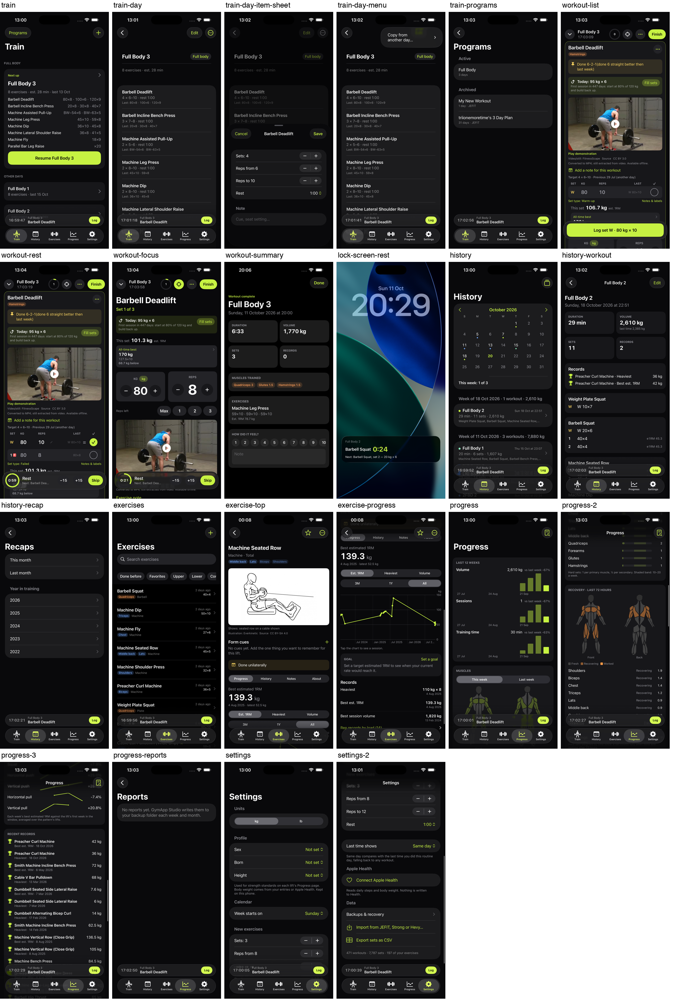

# Redesign step 1: inventory and audit

Captured 20 October 2026 in the simulator on a copy of the owner's data (471 workouts), with
a workout in progress. Every screen is in [screens/](screens/); the sheet below shows the phone
screens side by side. Studio pages are in screens/10.7-studio-*.jpg.

## How to read the marks

- **Must** — needed at that moment; must be visible without a tap or scroll.
- **Glance** — useful there; may be smaller or collapsed, one tap away.
- **Rare** — used now and then; belongs behind a menu, a disclosure or another screen.

## Screens

| Screen | File | What it is for |
|---|---|---|
| Train | train.png | Start or resume the next day; see other days |
| Day | train-day.png, train-day-item-sheet.png, train-day-menu.png | A program day's exercises and targets |
| Programs | train-programs.png | Active and archived programs |
| Workout, list | workout-list.png | Log sets, exercise by exercise |
| Workout, resting | workout-rest.png | The same with the rest bar |
| Workout, focus | workout-focus.png | One exercise, big controls |
| End of workout | workout-summary.png | Summary, comparisons, records |
| Lock screen | lock-screen-rest.png | Rest countdown and Log button |
| History | history.png | Calendar and weeks |
| Past workout | history-workout.png | One workout, editable |
| Recaps | history-recap.png | Months and years |
| Exercises | exercises.png | Library with filters |
| Exercise page | exercise-top.png, exercise-progress.png | Demonstration, cues, progress, records |
| Progress | progress.png, progress-2.png, progress-3.png | Twelve-week charts, muscles, recovery, trends, records, body |
| Reports | progress-reports.png | Studio's weekly and monthly reports |
| Settings | settings.png, settings-2.png | Units, profile, defaults, Health, data |

## Element audit

### Train (opened before every session)

| Element | Mark | Note |
|---|---|---|
| Next day name and Start/Resume | Must | The one action on this screen; good |
| Next day's exercises with last time | Glance | Useful; currently a static list, not tappable |
| Estimated time, last done | Glance | |
| Other days | Glance | Each opens a day |
| Programs button, + (new program, empty workout) | Rare | Top bar, fine |
| Studio suggestions | Glance | Appear only when there are some |
| Mini player (workout in progress) | Must | Good; duplicates Resume when on Train |

### Day

| Element | Mark | Note |
|---|---|---|
| Exercise rows: targets, rest, last time | Glance | |
| Tap a row | — | Opens sets/reps/rest/note only. **No way to the exercise's page, history or cues, and no swap from here** |
| Edit (reorder, remove), ⋯ (copy from another day) | Rare | Reorder hidden behind Edit; swap not offered at all |

### Workout, current exercise card (between sets, one hand)

Top to bottom today: name and muscle, sticky note, today's suggestion, demonstration (video,
about a quarter of the screen), credit lines, "Add a note for this workout", target line, set
table, set type and notes, this-set 1RM, best tiles, steppers, reps-left chips, other sets,
Add set, then the floating Log/Rest bar.

| Element | Mark | Note |
|---|---|---|
| Selected set: load × reps, steppers | Must | **Starts about 60% down the screen** on a 6.9" phone; below the fold on smaller ones |
| Log button / rest countdown | Must | Floating bar; good |
| What to beat (best tiles) | Must | Visible since 19 Oct; the rest bar can cover its lower half |
| Last time (LAST column) | Glance | Right size since 19 Oct |
| Today's suggestion | Glance | Takes a full-width box above the demonstration |
| Sticky note | Glance | Often long; pushes everything down |
| Form cues | Glance | Only when chosen |
| Demonstration video and credits | Rare mid-workout | **Largest item on the card, above the sets** |
| Workout note, set type, notes & labels, reps left | Rare | Each a full-width line |
| Card ⋯ menu: swap, history, warm-ups, superset, plate calculator, remove | Rare | Fine as a menu |
| Other exercises (collapsed cards) | Glance | Below the current card; long scroll to reach |

### Workout, focus mode

Better ordered than the list: name, "Set 1 of 3", suggestion, this-set 1RM, best, steppers,
reps left, then the demonstration. Its Log action is the floating bar. Nothing to fix but the
layout of the list should borrow this order.

### End of workout, History, past workout, recaps

| Element | Mark | Note |
|---|---|---|
| Summary: duration, volume, sets, records | Glance | Past workout shows them as **four equal tiles** (DESIGN.md tell 3) |
| Records list, per-exercise sets with e1RM | Glance | |
| Calendar | Glance | Good |
| Week list | Glance | Good |
| Recaps | Rare | Behind a small icon top right |

### Exercises and the exercise page

| Element | Mark | Note |
|---|---|---|
| Search, filter chips, rows with last set | Must | Good |
| Demonstration, cues | Glance | First on the page since 10.6 |
| Best 1RM headline, chart, records | Glance | |
| History / Notes / About segments | Rare | |

### Progress

| Element | Mark | Note |
|---|---|---|
| This week vs last: volume, sessions, time | Glance | Three similar bar charts stacked |
| Muscles this week (body map, sets per muscle) | Glance | |
| Recovery, last 72 h | Glance | Second body map |
| Movement-pattern trends, recent records | Glance | |
| Body weight, steps | Rare | |
| Reports | Rare | Small icon top right |

One long scroll of about five screens with two body maps: the "too much at once" page.

### Settings

Units, profile, calendar, new-exercise defaults, last-time source, Apple Health, backups,
import and export. All rare; layout is fine.

### Lock screen

Rest countdown, next set and Log. Must. Good.

### GymApp Studio (Mac)

Restyled in 10.7: sidebar, toolbar, ⌘K, overview hero. Visual language matches the phone's
colours but not yet its type scale, spacing or components (no shared source).

## What the audit says, in short

1. **Train → day → exercise is a dead end.** The day lists exercises but tapping one only edits
   its targets; the exercise page, history, cues and swap are not reachable from a plan.
2. **The workout card puts rare things above must-have things.** The demonstration, its
   credits, the sticky note and the workout note sit above the set you are about to lift.
3. **Progress is one long page** where everything is the same weight.
4. **Equal-tile grids remain** on the past-workout summary.
5. **Small top-bar icons hide useful screens** (Recaps, Reports).
6. **The two apps share colours by hand**, not by a common definition.

## Still to do for this step

- **The session recording.** Waiting for the owner's screen recording; hesitations and
  mis-taps will be added here.
- **On-device usage counts** (needs approval, as it is code): a local count per screen opened
  and per button tapped, kept in the app's database, never sent anywhere, with a "Usage"
  line under Settings → Data that exports the counts as CSV. Proposed shape: one table
  `usageCount(key TEXT PRIMARY KEY, count INTEGER, lastAt TEXT)`, keys like
  `screen.workout`, `tap.log`, `tap.bestTile`. About 30 lines plus a test.
